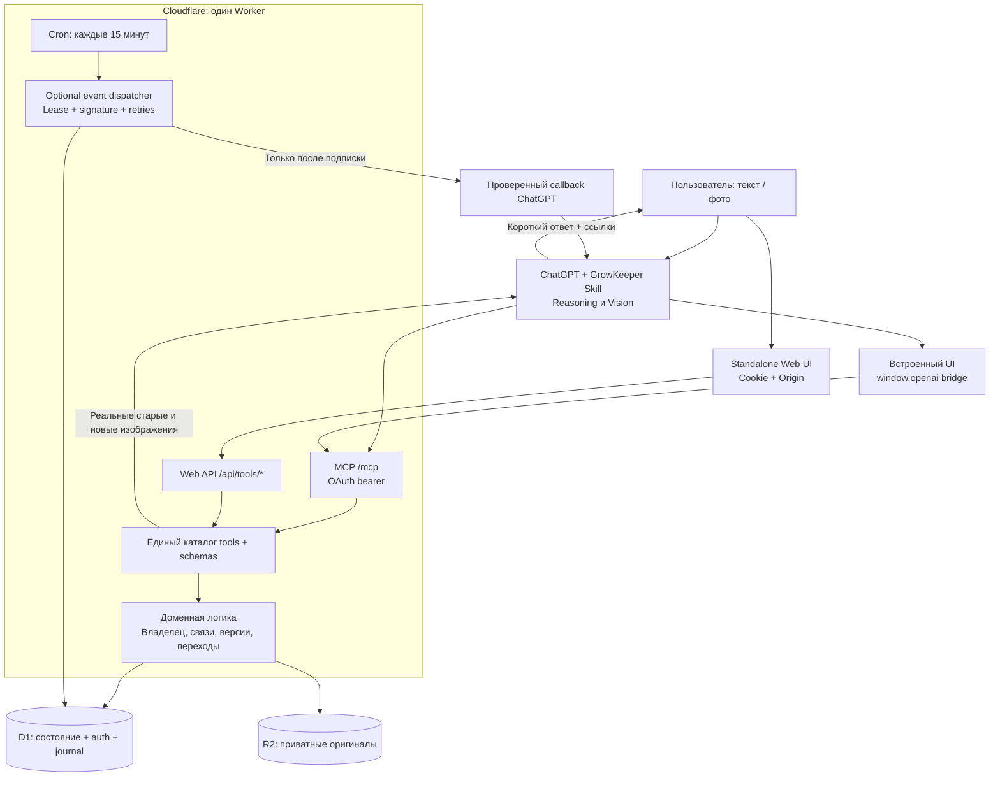
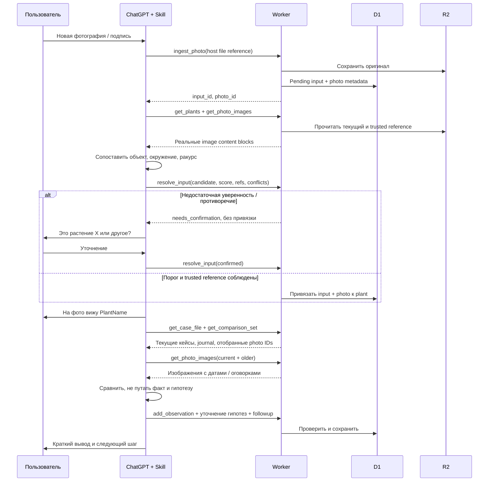
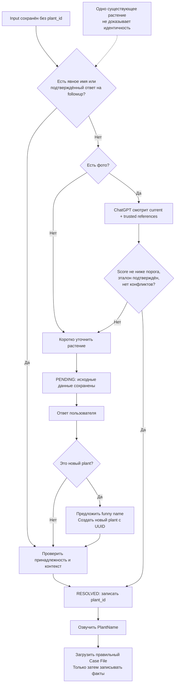
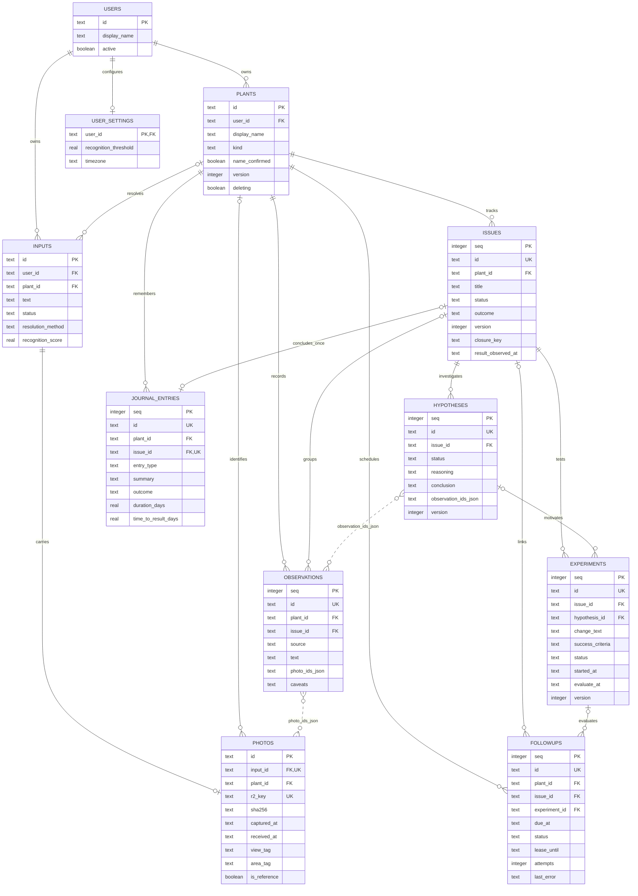
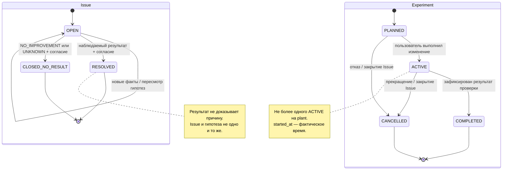
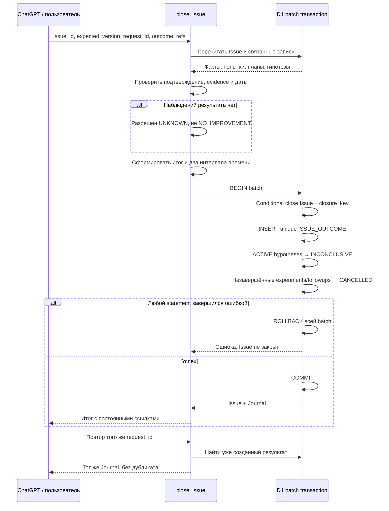
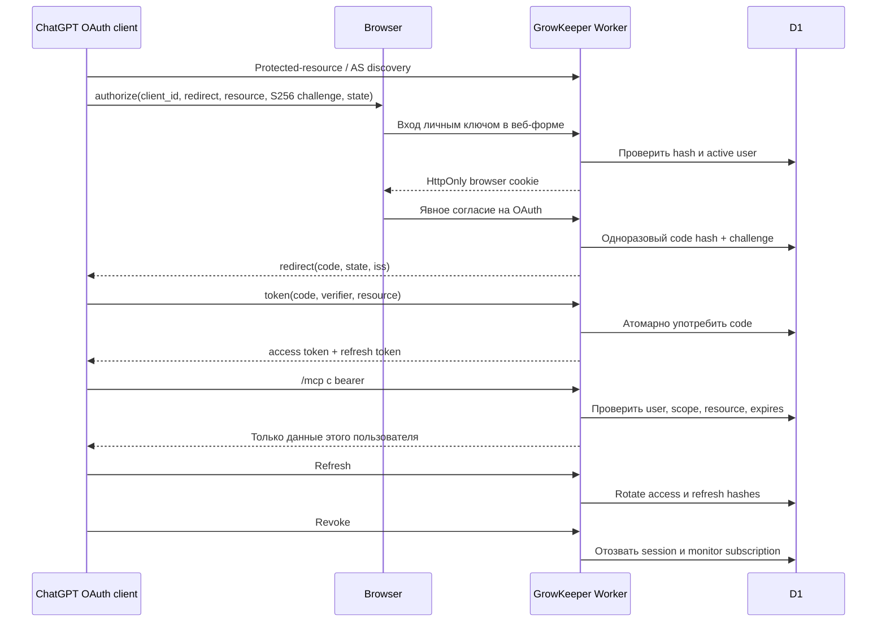
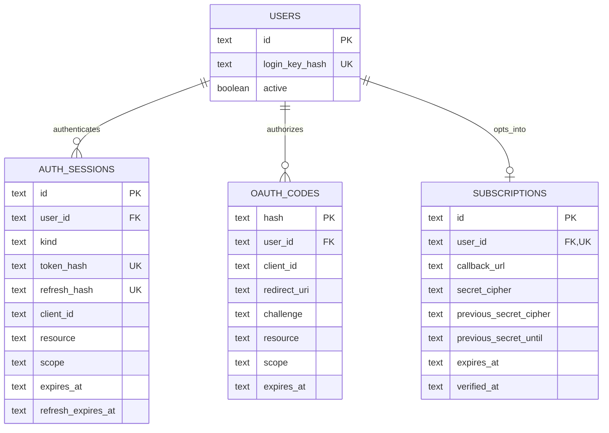

# GrowKeeper — схемы реализации v0.2.0

Исходники находятся в `diagrams/*.mmd`. Генерация этого документа: `npm run diagrams`. Проверка структуры выполняется в `npm run check`; полноценный Mermaid renderer в этой сборочной среде не запускался.

## 01-architecture



## 02-photo-processing



## 03-plant-resolution



## 04-database-domain



## 05-case-and-experiment-states



## 06-atomic-journal



## 07-native-followups

```mermaid
sequenceDiagram
    participant U as Пользователь
    participant H as ChatGPT host
    participant W as Worker
    participant D as D1
    participant T as Cron
    U->>H: Явно включить монитор GrowKeeper
    H->>W: events/subscribe + callback + signing secret
    W->>H: Подписанный verification challenge
    H-->>W: 2xx + echo challenge
    W->>D: Одна зашифрованная subscription с expiry
    W-->>H: subscription ID + refreshBefore
    T->>W: Каждые 15 минут
    W->>D: Due PENDING + active subscription + lease
    D-->>W: Контекст plant/followup
    W->>H: Signed event с постоянным eventId
    alt Callback вернул 2xx
        W->>D: NOTIFIED, освободить lease
        H->>U: Краткий запрос наблюдения
    else Transient failure
        W->>D: PENDING + backoff + attempts
    else 410 или 413
        W->>D: Удалить subscription, прекратить доставку
    end
    U->>H: Фото / ответ
    H->>W: Обработать факт; update_followup DONE
    U->>H: Остановить мониторинг
    H->>W: events/unsubscribe по исходной identity
    W->>D: Удалить subscription
```

## 08-oauth



## 09-auth-storage



