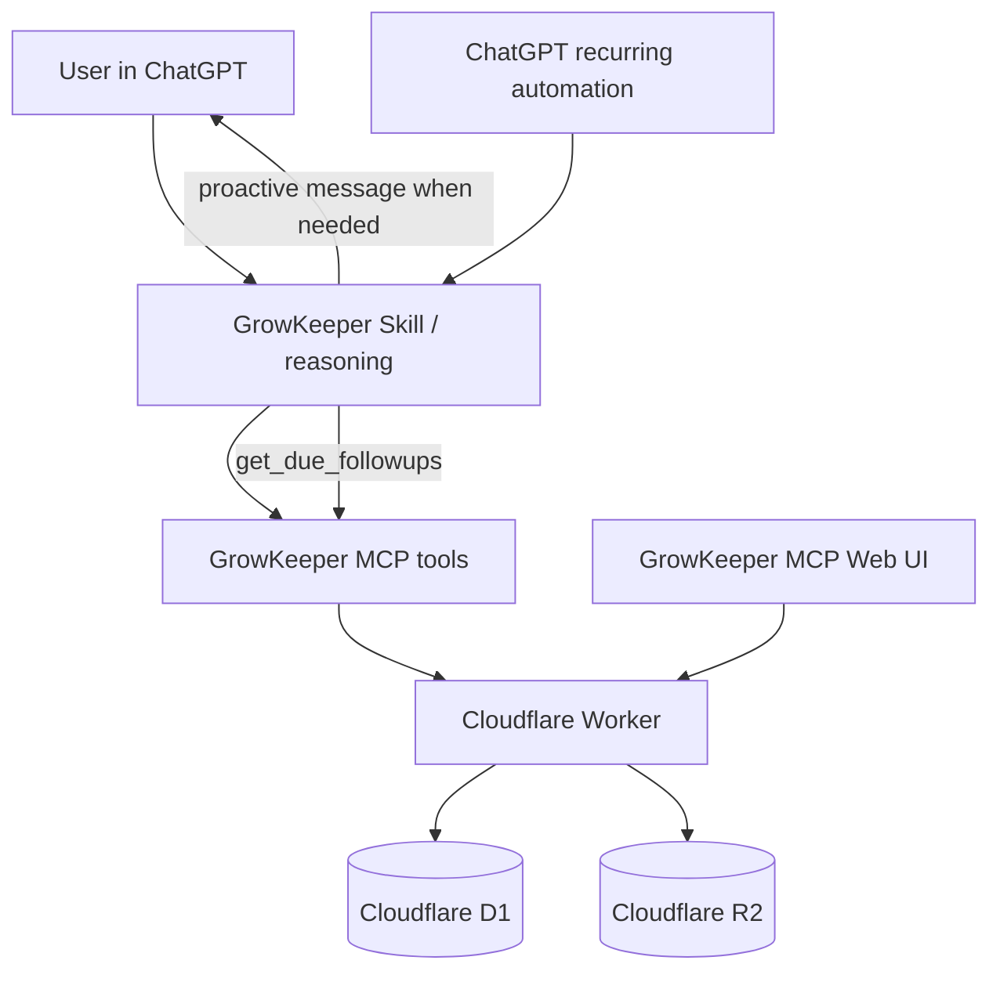
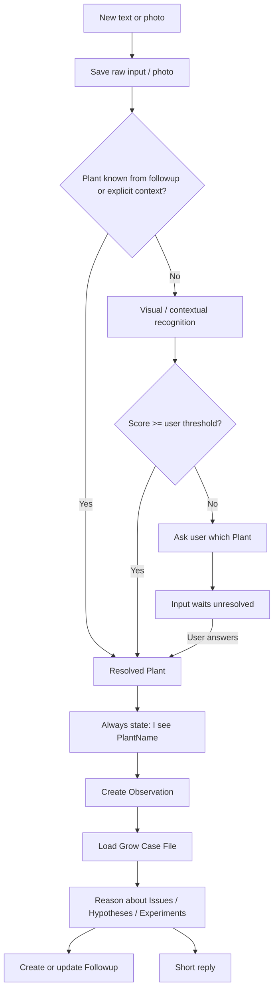
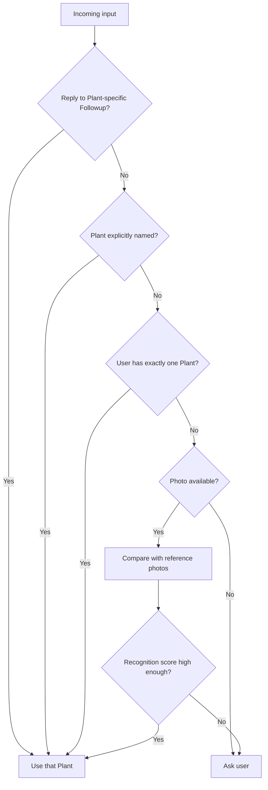
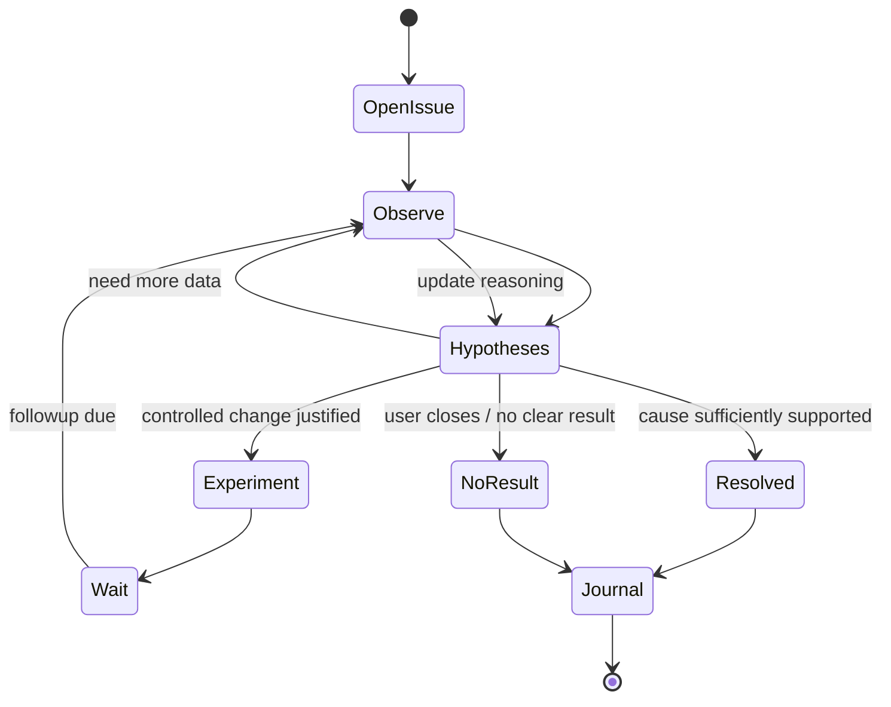
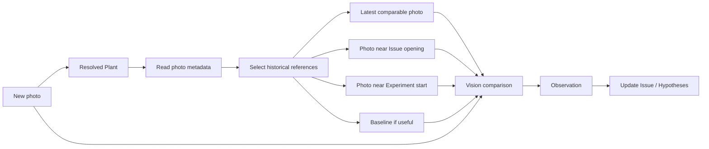
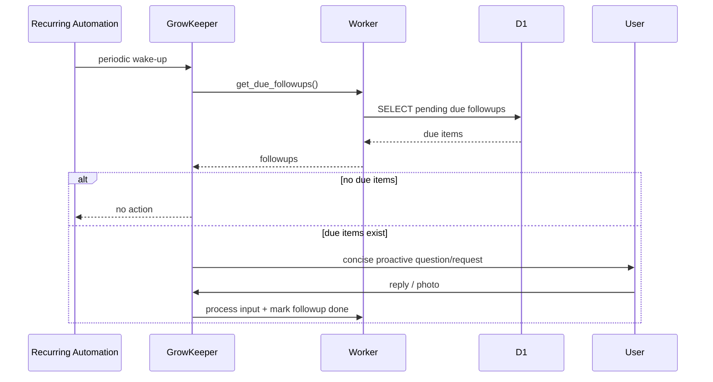
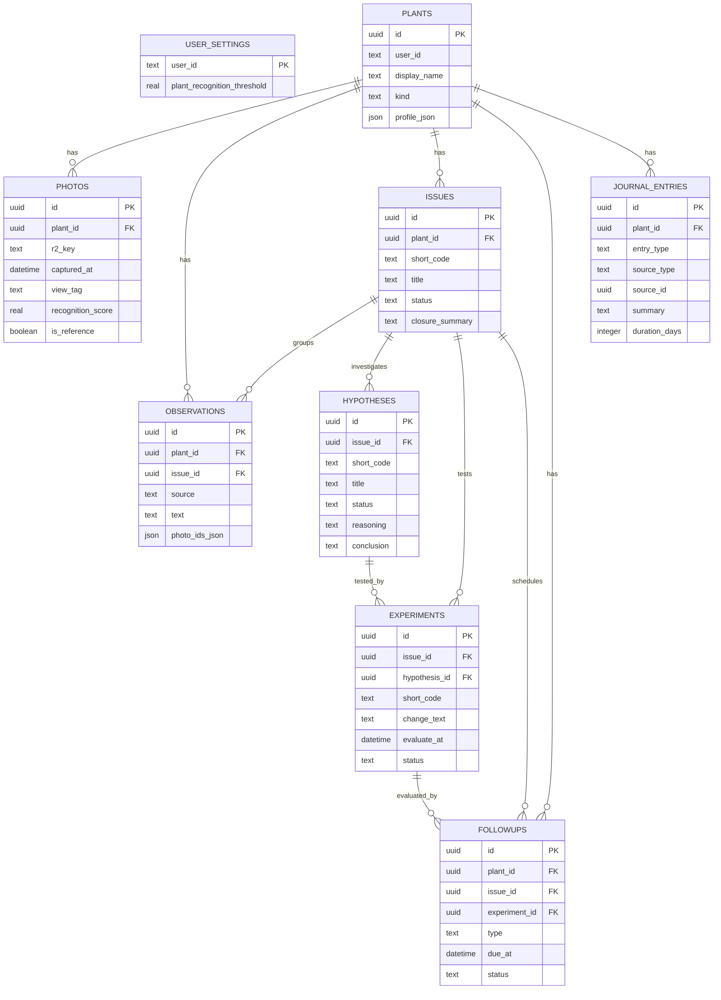
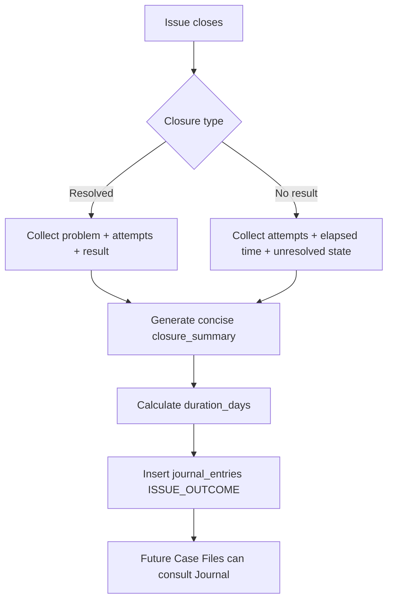

# GrowKeeper — PRD

**Version:** 0.1  
**Status:** Draft / MVP  
**Product:** ChatGPT Plugin / MCP App  
**Backend:** Cloudflare Workers + D1 + R2  
**Core principle:** **KISS — минимум сущностей, минимум скрытой автоматики, максимум проверяемой пользы.**

---

## 1. Product idea

GrowKeeper — инициативный помощник по выращиванию растений и грядок внутри ChatGPT.

Его задача — не выдавать одноразовые советы, а **вести Grow Case File во времени**:

- помнить состояние каждого plant;
- автоматически привязывать новые сообщения и фотографии к нужному plant;
- замечать проблемы;
- создавать и проверять гипотезы;
- планировать наблюдения и простые эксперименты;
- сравнивать текущие фотографии с историческими;
- первым возвращаться к пользователю в нужный момент;
- при закрытии проблемы сохранять краткий итог в долгосрочный Plant Journal.

Пользователь не обязан помнить, каким было растение несколько дней назад.  
Пользователь просто присылает фотографии, измерения и короткие комментарии. GrowKeeper сам поднимает релевантную историю.

---

## 2. KISS как обязательное архитектурное правило

Для GrowKeeper KISS важнее потенциальной расширяемости.

### 2.1. Правила KISS

1. **Не создавать отдельную сущность, если достаточно поля в существующей таблице.**
2. **Не хранить то, что легко вычислить из существующих данных.**
3. **Не автоматизировать действие, если ошибка автоматики дороже одного уточняющего вопроса.**
4. **Не добавлять vector DB, embeddings, multi-agent, event sourcing и сложные scoring-модели до появления реальной необходимости.**
5. **LLM отвечает за reasoning, backend — за факты и долговременное состояние.**
6. **Факт и гипотеза никогда не смешиваются.**
7. **Все сущности должны быть понятны человеку через короткие ID и названия.**
8. **Каждое усложнение должно иметь измеримую пользу для пользователя или debugging.**

### 2.2. Что сознательно НЕ используется в MVP

- Cloudflare KV;
- отдельный Event Store / Timeline table;
- отдельная таблица Evidence;
- vector DB;
- image embeddings;
- сложное компьютерное зрение для идентификации plants;
- отдельная PhotoComparison table;
- отдельная PhotoRequest table;
- отдельная Checkpoint table;
- LangGraph;
- multi-agent архитектура;
- управление физическим оборудованием;
- автоматическое изменение питания/полива без пользователя.

---

# 3. Терминология

## Plant

`Plant` — логическая единица наблюдения GrowKeeper.

Это может быть:

- одно растение;
- одна грядка;
- контейнер;
- группа одинаковых растений.

Внутри системы каждый Plant имеет UUID и человекочитаемое имя.

Примеры:

- `Зелёный Борис`
- `Три богатыря`
- `Огуречный профсоюз`

---

## Grow Case File

Полное рабочее состояние одного Plant:

- фотографии;
- observations;
- открытые issues;
- hypotheses;
- experiments;
- followups;
- Plant Journal.

---

## Observation

**Наблюдаемый факт**, а не вывод модели.

Пример:

> На двух нижних листьях увеличилась зона межжилкового пожелтения.

Нельзя записывать как Observation:

> У растения дефицит магния.

Это Hypothesis.

---

## Issue

Проблема, которую GrowKeeper отслеживает во времени.

Пример:

`I14 · Пожелтение нижних листьев`

---

## Hypothesis

Возможное объяснение Issue.

Пример:

`H17 · Возможный дефицит Mg`

---

## Experiment

Осознанное изменение условий для проверки Hypothesis.

Пример:

`E12 · Увеличить Mg примерно на 15%`

---

## Followup

Одна универсальная сущность для будущего действия.

Заменяет:

- checkpoint;
- photo request;
- next action;
- reminder;
- scheduled observation.

Пример:

> 4 октября попросить общий вид + крупно нижние листья для оценки E12.

---

## Plant Journal

Отдельная долгосрочная память Plant.

Это **не полный лог событий**.

Plant Journal хранит сжатые выводы, которые будут полезны через недели и месяцы:

- закрытые Issues;
- важные milestones;
- ручные notes.

---

# 4. Основные пользовательские сценарии

## 4.1. Первый Plant

Пользователь присылает фотографию.

GrowKeeper определяет, что существующего Plant нет.

Создаётся новый Plant.

GrowKeeper предлагает friendly/funny name:

> Похоже, это новый plant. Можем назвать его **«Зелёный Борис»**, или предложи свой вариант.

Название не влияет на внутренний UUID и может быть изменено позже.

---

## 4.2. Повторная фотография

Пользователь просто присылает фото без пояснений.

GrowKeeper пытается определить Plant.

Если confidence выше пользовательского threshold:

> На фото вижу **Зелёного Бориса**.

Фото автоматически привязывается к этому Plant.

Если confidence ниже threshold:

> Похоже на **Зелёного Бориса**, но не уверен. Это он?

До ответа пользователя фото остаётся сохранённым, но `plant_id = NULL`.

После ответа обработка исходной фотографии продолжается автоматически.

---

## 4.3. Проблема развивается несколько дней

Пользователь сообщает:

> Нижние листья желтеют.

GrowKeeper:

1. создаёт Observation;
2. создаёт или обновляет Issue;
3. создаёт несколько разумных Hypotheses;
4. определяет, что лучше проверить дальше;
5. создаёт Followup;
6. отвечает кратко.

Пример ответа:

> **I14 · Пожелтение нижних листьев**  
> Основная версия: **H17 · возможный дефицит Mg**.  
> Пока ничего больше не меняй. Через 3 дня сравним нижние листья.

---

## 4.4. Инициативное наблюдение

Когда наступает `followup.due_at`, GrowKeeper первым пишет пользователю.

Пример:

> **Зелёный Борис:** пришли общий вид и крупно 1–2 нижних листа. Проверяем, остановилось ли распространение **I14**.

---

## 4.5. Закрытие Issue

При закрытии Issue автоматически создаётся запись в Plant Journal.

Успешный пример:

> Пожелтение нижних листьев.  
> Проверялись Mg, pH и переувлажнение. После увеличения Mg новые симптомы почти прекратились через 4 дня. Issue закрыт через 7 дней.

Принудительное закрытие без результата:

> Скручивание молодых листьев.  
> За 11 дней проверены снижение EC и изменение режима полива. Устойчивого улучшения не получено. Причина не установлена.

---

# 5. Product requirements

## FR-1. Multi-Plant без ручного переключателя

Пользователь не должен вручную выбирать текущий Plant.

Каждый входящий текст или фото сначала проходит Plant Resolution.

GrowKeeper может:

- автоматически определить Plant;
- определить Plant из контекста Followup;
- определить Plant по явному имени;
- задать короткий уточняющий вопрос.

Диагностическая обработка не должна записывать данные в Grow Case File, пока Plant не определён.

---

## FR-2. Friendly names

При создании нового Plant GrowKeeper генерирует одно короткое friendly/funny имя и предлагает его пользователю.

Пользователь может:

- принять;
- заменить;
- переименовать позже в UI.

Внутренние связи используют UUID, а не display name.

---

## FR-3. Visual Plant Recognition

При загрузке фото GrowKeeper должен пытаться определить Plant по:

1. контексту текущего Followup;
2. явному текстовому контексту;
3. визуальному сравнению с reference photos существующих Plants.

В MVP **не используются embeddings**.

### Правило автоматического принятия

```text
recognition_score >= user_threshold
    → auto bind
recognition_score < user_threshold
    → ask user
```

`recognition_score` — эвристический score, а не статистически калиброванная вероятность.

### UX requirement

При автоматической привязке GrowKeeper всегда пишет:

> На фото вижу **{PlantName}**.

Threshold настраивается в Web UI.

Default: `0.90`.

---

## FR-4. Photo archive

Оригиналы фотографий сохраняются в Cloudflare R2.

D1 хранит метаданные.

Минимальные метаданные:

- `plant_id`;
- `r2_key`;
- `received_at`;
- `captured_at`;
- `view_tag`;
- `analysis_json`;
- `recognition_score`;
- `is_reference`.

Если `captured_at` неизвестен, используется `received_at`.

---

## FR-5. Photo labels

GrowKeeper автоматически присваивает фото небольшое количество технических labels.

Минимальный набор `view_tag`:

- `WHOLE_PLANT`;
- `CANOPY`;
- `LEAF_CLOSEUP`;
- `ROOT_ZONE`;
- `OTHER`.

Новые labels не добавляются без реальной необходимости.

---

## FR-6. Historical photo comparison

Пользователь не выбирает старые фотографии вручную.

Для нового фото GrowKeeper выбирает максимум несколько релевантных reference photos.

Приоритет:

1. последнее сравнимое фото того же Plant;
2. фото около момента открытия текущего Issue;
3. фото около начала активного Experiment;
4. baseline/reference photo.

Обычно модели передаётся 2–4 старых фото, а не весь архив.

Результат сравнения сохраняется как Observation.

Отдельной сущности `PhotoComparison` в MVP нет.

---

## FR-7. Issues

Issue имеет короткий ID и название.

Статусы:

- `OPEN`;
- `RESOLVED`;
- `CLOSED_NO_RESULT`.

Минимально хранится:

- title;
- opened_at;
- closed_at;
- outcome;
- closure_summary.

---

## FR-8. Hypotheses

Hypothesis всегда принадлежит Issue.

Статусы:

- `ACTIVE`;
- `SUPPORTED`;
- `REJECTED`;
- `INCONCLUSIVE`.

Минимально хранится:

- title;
- reasoning;
- conclusion;
- observation_refs.

GrowKeeper не должен выдавать Hypothesis за факт.

---

## FR-9. Experiments

Experiment используется только когда действительно изменяются условия для проверки Hypothesis.

До начала Experiment должны быть записаны:

- что меняем;
- зачем;
- когда оцениваем;
- что будет считаться ожидаемым результатом.

Статусы:

- `ACTIVE`;
- `COMPLETED`;
- `CANCELLED`.

---

## FR-10. Followups

Все будущие действия хранятся в одной таблице `followups`.

Типы MVP:

- `ASK_STATUS`;
- `REQUEST_PHOTO`;
- `EVALUATE_EXPERIMENT`;
- `RECHECK_ISSUE`.

Статусы:

- `PENDING`;
- `DONE`;
- `CANCELLED`.

---

## FR-11. Proactive behavior

Инициативность строится вокруг due Followups.

Не создаётся отдельный Scheduled Task на каждую гипотезу.

Предпочтительная схема:

- одна recurring automation на пользователя;
- automation вызывает `get_due_followups`;
- если due действий нет — ничего не отправляется;
- если есть — GrowKeeper формирует краткое сообщение.

---

## FR-12. Plant Journal

Plant Journal хранится в отдельной таблице `journal_entries`.

Entry types MVP:

- `ISSUE_OUTCOME`;
- `MILESTONE`;
- `NOTE`.

При закрытии Issue backend автоматически создаёт `ISSUE_OUTCOME`.

Для `ISSUE_OUTCOME` обязательно:

- ссылка на source Issue;
- краткое описание проблемы;
- что проверяли/меняли;
- итог;
- duration_days;
- успешность или отсутствие результата.

Plant Journal — основной источник исторического опыта при появлении похожей проблемы в будущем.

---

## FR-13. Short conversational UX

GrowKeeper не должен писать длинные агрономические лекции без запроса.

Обычный ответ:

1. что видим;
2. текущая версия;
3. что делать/наблюдать дальше.

Максимум 1–2 вопроса за раз.

---

## FR-14. Clickable entity IDs

В чате сущности показываются как:

- `I14 · Пожелтение нижних листьев`
- `H17 · Возможный дефицит Mg`
- `E12 · Mg +15%`

ID должен вести в GrowKeeper Web UI на соответствующую карточку.

---

# 6. Web UI MVP

Один React/TypeScript MCP App.

Не создавать отдельные приложения для Issues, Hypotheses и Journal.

## Экраны

### Plant overview

Показывает:

- имя Plant;
- последнее фото;
- открытые Issues;
- активные Hypotheses;
- активные Experiments;
- ближайшие Followups.

### Entity detail

Открывается по deep link:

```text
/entity/issue/{id}
/entity/hypothesis/{id}
/entity/experiment/{id}
```

### Plant Journal

Список долгосрочных записей одного Plant.

### Settings

MVP setting:

- Plant recognition threshold.

Позже настройки можно расширять без изменения архитектуры.

---

# 7. Архитектура



### Архитектурные ограничения

- KV не используется.
- D1 — единственный structured state store.
- R2 — единственное photo/object storage.
- Worker — stateless.
- Reasoning не дублируется отдельным AI backend.
- Web UI и MCP используют один backend.

---

# 8. Inbound processing flow



---

# 9. Plant Resolver logic

Plant Resolver deliberately remains simple.



No embeddings or vector DB in MVP.

---

# 10. Issue → Hypothesis → Experiment lifecycle



Главное правило: новый день не запускает диагностику с нуля. GrowKeeper продолжает существующий Case File.

---

# 11. Photo comparison flow



Не более нескольких reference photos за одну обычную проверку.

---

# 12. Proactive followup flow



---

# 13. Database model

## 13.1. Tables

### `plants`

```text
id                  UUID PK
user_id             TEXT
display_name        TEXT
name_source         generated | user
kind                plant | bed | group
profile_json        JSON
created_at          DATETIME
updated_at          DATETIME
```

### `photos`

```text
id                  UUID PK
plant_id            UUID NULL
r2_key              TEXT
received_at         DATETIME
captured_at         DATETIME
view_tag            TEXT
analysis_json       JSON
recognition_score   REAL NULL
is_reference        BOOLEAN
created_at          DATETIME
```

`plant_id = NULL` означает, что фото ожидает разрешения Plant.

### `observations`

```text
id                  UUID PK
plant_id            UUID
issue_id            UUID NULL
source              user | photo | comparison
text                TEXT
photo_ids_json      JSON
created_at          DATETIME
```

### `issues`

```text
id                  UUID PK
plant_id            UUID
short_code          TEXT
title               TEXT
status              OPEN | RESOLVED | CLOSED_NO_RESULT
opened_at           DATETIME
closed_at           DATETIME NULL
outcome             TEXT NULL
closure_summary     TEXT NULL
created_at          DATETIME
updated_at          DATETIME
```

### `hypotheses`

```text
id                  UUID PK
issue_id            UUID
short_code          TEXT
title               TEXT
status              ACTIVE | SUPPORTED | REJECTED | INCONCLUSIVE
reasoning           TEXT
conclusion          TEXT NULL
observation_refs    JSON
created_at          DATETIME
closed_at           DATETIME NULL
updated_at          DATETIME
```

### `experiments`

```text
id                  UUID PK
issue_id            UUID
hypothesis_id       UUID NULL
short_code          TEXT
change_text         TEXT
success_criteria    TEXT
started_at          DATETIME
evaluate_at         DATETIME
status              ACTIVE | COMPLETED | CANCELLED
result              TEXT NULL
created_at          DATETIME
updated_at          DATETIME
```

### `followups`

```text
id                  UUID PK
plant_id            UUID
issue_id            UUID NULL
experiment_id       UUID NULL
type                ASK_STATUS | REQUEST_PHOTO | EVALUATE_EXPERIMENT | RECHECK_ISSUE
context             TEXT
due_at              DATETIME
status              PENDING | DONE | CANCELLED
created_at          DATETIME
updated_at          DATETIME
```

### `journal_entries`

```text
id                  UUID PK
plant_id            UUID
entry_type          ISSUE_OUTCOME | MILESTONE | NOTE
source_type         issue | manual | system
source_id           UUID NULL
title               TEXT
summary             TEXT
outcome             TEXT NULL
duration_days       INTEGER NULL
occurred_at         DATETIME
created_at          DATETIME
```

### `user_settings`

```text
user_id                         TEXT PK
plant_recognition_threshold    REAL DEFAULT 0.90
updated_at                      DATETIME
```

---

## 13.2. ER diagram



---

# 14. Plant Journal generation



Journal entry должен быть коротким и полезным для будущего reasoning, а не копией всей переписки.

---

# 15. Minimal MCP/API surface

Названия инструментов могут измениться, но surface должен оставаться маленьким.

## Read

```text
get_plants()
get_plant_case_file(plant_id)
get_plant_journal(plant_id, query?, limit?)
get_due_followups()
get_photo_context(photo_id)
```

## Write

```text
create_or_update_plant(...)
ingest_photo(...)
add_observation(...)
upsert_issue(...)
upsert_hypothesis(...)
upsert_experiment(...)
upsert_followup(...)
add_journal_note(...)
```

### Backend automatic actions

Эти действия не требуют отдельного LLM tool:

- при закрытии Issue → создать `ISSUE_OUTCOME`;
- при подтверждении Plant → привязать pending photo;
- при завершении Followup → `status = DONE`;
- при закрытии Issue → незавершённые Hypotheses сделать `INCONCLUSIVE`, если они не получили итоговый статус.

---

# 16. Entity links / Web UI

Каждый объект имеет:

- UUID для backend;
- короткий scoped code для человека.

Пример:

```text
I14
H17
E12
```

В чате всегда показывается ID + title:

```text
I14 · Пожелтение нижних листьев
H17 · Возможный дефицит Mg
E12 · Увеличение Mg на 15%
```

Deep link открывает Web UI на нужной карточке.

Короткие codes не используются как database PK.

---

# 17. Short code generation

Коды генерируются последовательно в рамках пользователя или Plant:

```text
Issue      → I1, I2, I3...
Hypothesis → H1, H2, H3...
Experiment → E1, E2, E3...
```

MVP не требует сложной глобальной нумерации.

---

# 18. Reasoning rules

GrowKeeper Skill должен соблюдать правила:

1. Observation ≠ Hypothesis.
2. Не начинать расследование заново, если уже есть открытый Issue.
3. Не закрывать Issue только потому, что старый повреждённый лист не восстановился.
4. Перед Experiment определить ожидаемый результат и срок проверки.
5. По возможности менять одну значимую переменную за раз.
6. Не создавать много Hypotheses без диагностической пользы.
7. Не задавать пользователю вопрос, если ответ уже есть в Grow Case File.
8. Не просить пользователя вспомнить состояние растения, если можно сравнить фотографии.
9. При появлении похожего Issue сначала просмотреть Plant Journal.
10. Не маскировать сомнение: если Plant не определён уверенно — спросить.
11. Обычный ответ должен быть коротким.
12. При автоматическом распознавании фото явно называть распознанный Plant.

---

# 19. Debugging / observability

KISS применяется и здесь.

MVP не хранит отдельный event-sourcing лог.

Минимально необходимо:

- Cloudflare Worker request/error logs;
- `created_at` / `updated_at` на изменяемых сущностях;
- correlation/request ID в Worker logs;
- структурированные ошибки MCP tools;
- возможность посмотреть raw DB state через developer/admin tooling.

Если появится реальная потребность в аудите истории изменений, отдельный activity log добавляется позже.

---

# 20. Security / privacy

- Фото хранятся приватно в R2.
- R2 objects не должны иметь публичные постоянные URL.
- Worker выдаёт только временный или проксируемый доступ.
- Все D1 запросы scoped по authenticated user.
- UUID нельзя считать механизмом авторизации.
- Пользователь может удалить Plant вместе с его фотографиями и связанными данными.
- Физическое управление оборудованием отсутствует в MVP.

---

# 21. Non-goals MVP

Не реализуем:

- управление насосами/светом/дозаторами;
- автоматические изменения EC/pH;
- sensor telemetry;
- disease classifier как отдельную ML-модель;
- image embeddings;
- vector search;
- fine-tuning;
- social features;
- публичные Plant pages;
- сложные графики;
- мультиагентную систему;
- научную количественную confidence calibration.

---

# 22. MVP priorities

## P0 — обязательно

- Plants;
- funny/friendly naming;
- multi-Plant resolver;
- R2 photo archive;
- configurable recognition threshold;
- always announce recognized Plant;
- Observations;
- Issues;
- Hypotheses;
- Experiments;
- Followups;
- proactive scheduled followup;
- Plant Journal;
- automatic Issue closure summary;
- Web UI entity pages;
- clickable entity references.

## P1 — после первого рабочего выращивания

- improved visual recognition;
- automatic reference-photo selection quality;
- richer Plant overview;
- Journal search improvements;
- manual correction of misclassified photos;
- photo timeline UI.

## P2 — только при доказанной необходимости

- image embeddings/vector DB;
- dedicated Evidence model;
- event history / audit log;
- sensor ingestion;
- hardware actions;
- multi-agent reasoning.

---

# 23. MVP acceptance criteria

MVP считается рабочим, если выполняются все сценарии:

1. Пользователь создаёт два разных Plants и больше не переключается между ними вручную.
2. GrowKeeper корректно привязывает очевидное фото к Plant и пишет его имя.
3. При недостаточном recognition score GrowKeeper спрашивает пользователя до записи данных в Case File.
4. Пользователь может изменить recognition threshold в Web UI.
5. Все фотографии сохраняются в R2 и доступны для последующего сравнения.
6. GrowKeeper может сравнить текущее фото с релевантными прошлыми фото без участия пользователя.
7. Проблема создаётся как Issue, а возможные причины — отдельно как Hypotheses.
8. Experiment имеет заранее определённый срок оценки.
9. GrowKeeper инициирует Followup в установленный момент.
10. Закрытие успешного Issue создаёт Journal entry с результатом и числом дней.
11. Принудительное закрытие без результата создаёт Journal entry с предпринятыми попытками и числом дней без результата.
12. `I/H/E` ссылки из чата открывают соответствующую карточку Web UI.
13. Reasoning нового похожего Issue может использовать прошлые Journal entries.
14. Backend работает только на Workers + D1 + R2 без KV и отдельной базы.

---

# 24. Ключевая продуктовая формула

```text
Photo/Text
   ↓
Resolve Plant
   ↓
Observation
   ↓
Issue
   ↓
Hypotheses
   ↓
Observation or Experiment
   ↓
Followup
   ↓
New evidence over time
   ↓
Issue outcome
   ↓
Plant Journal
   ↓
Better decisions next time
```

Главная ценность GrowKeeper — не одноразовая диагностика, а накопление проверенного опыта конкретного растения/грядки во времени.
